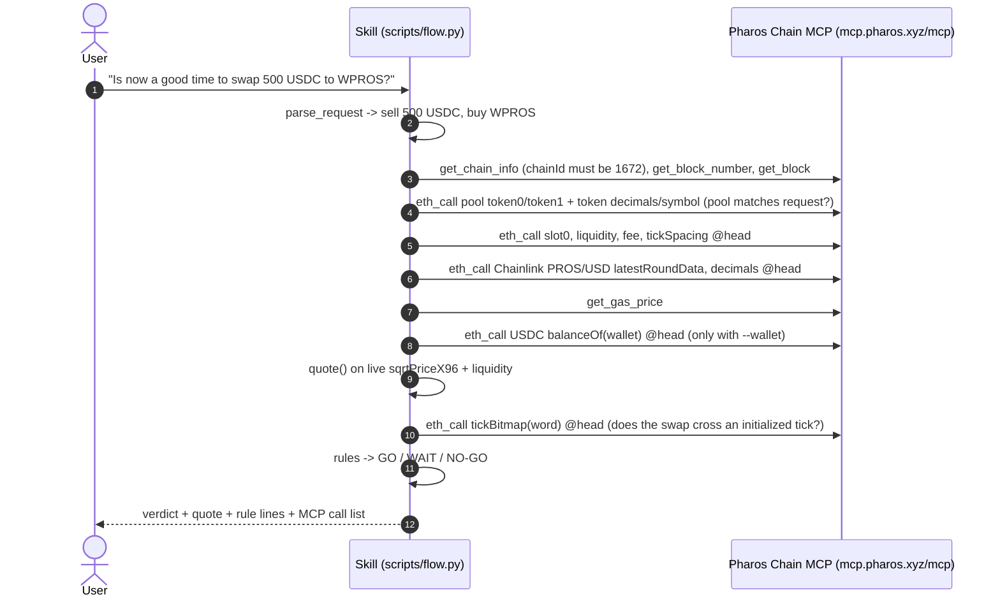

# Pharos Agent Arena · Skill + Chain MCP Flow — "is now a good time to swap?"

One agent flow where a **SkillEngine-format Skill** makes the decision and the hosted **Pharos Chain MCP**
(`https://mcp.pharos.xyz/mcp`) supplies the live chain data, in one run, from one user request:

```bash
python3 scripts/flow.py "Is now a good time to swap 500 USDC to WPROS?" --wallet 0x84dbd23178ba7fc6a2a396559139aef69d0f072a
```

The Skill parses the request → asks Chain MCP for the WPROS/USDC pool state (`slot0`, `liquidity`, `fee`,
`tickSpacing`, `tickBitmap`), Chainlink PROS/USD, gas price and the wallet balance, all pinned to one block →
computes the exact in-range Uniswap-V3 quote and price impact on that live state → applies its rules → **GO /
WAIT / NO-GO**, with every Chain MCP call listed (tool, contract.function, block, latency, result).

Decision only: no swap transaction is built, signed or sent, and no key is involved.

Built for the Pharos *Season of AI · Agent Arena* task
[Skill + Chain MCP Flow](https://pharos-agent-arena.vercel.app/tasks/skill-chain-mcp-flow).

## Requirements → where they are met

| # | Requirement | How |
|---|---|---|
| 1 | Skill output depends on live Chain MCP data in the same flow | quote, impact, tick-crossing, pool-vs-oracle deviation, oracle age, gas and balance rules are all computed from values fetched by Chain MCP in that run; change the block and the verdict changes (samples 01–05 give GO, WAIT and NO-GO on the same pool). |
| 2 | End to end from a single user request | `scripts/flow.py "<sentence>"` — parse → fetch → decide → answer; nothing else to call. |
| 3 | Diagram / write-up of what calls what | Mermaid sequence diagram below and in `references/flow.md`; every run also prints its own ordered list of MCP calls. |
| 4 | Demo run with real data through both tools | `samples/01…05` (Pharos mainnet blocks ~20,256,6xx, 2026-10-14 22:27–22:28 UTC), JSON in `samples/06`, and `samples/07_backtest_real_swaps.txt`: the skill's quote vs 8 real swaps, worst difference 0.000002 %. |

## Flow



## Skill format

```
SKILL.md                 agent entry point (official pharos-skill-engine frontmatter: name, description, version, requires)
references/flow.md       diagram, quote formulas, rules, backtest method
assets/networks.json     official pharos-skill-engine network file (unchanged copy)
assets/rules.json        decision thresholds; rules.strict.json = 0.1 % oracle deviation
scripts/flow.py          the flow (Skill logic + recorded Chain MCP calls)
scripts/backtest.py      quote() vs real Swap events
scripts/skill_chain.py, pay_core.py, pharos_mcp.py   shared readers + MCP client
samples/  tests/
```

## Run it

```bash
python3 -m venv .venv && . .venv/bin/activate
pip install -r requirements.txt
python3 scripts/flow.py "Is now a good time to swap 500 USDC to WPROS?" --wallet 0x84dbd23178ba7fc6a2a396559139aef69d0f072a
python3 scripts/flow.py "swap 20000 WPROS for USDC" --json
python3 scripts/backtest.py --blocks 600 --max 8
python3 -m unittest discover -s tests
```

Exit codes: 0 GO, 3 WAIT, 4 NO-GO, 2 error (e.g. no amount in the request → the skill asks for it).

## Real sample output

`samples/01_go_500_usdc.txt` (block #20,256,616, 2026-10-14 22:27:40 UTC; 18 Chain MCP calls, first ones shown):

```
Request: "Is now a good time to swap 500 USDC to WPROS?"
[1 SKILL] parsed -> sell 500 USDC, buy WPROS on pool WPROS/USDC 0x912c9ade24d44d8922f0866d8dcb079f1363f647
[2 CHAIN MCP] https://mcp.pharos.xyz/mcp (pharos-mcp-server 0.1.0) - 18 calls, block #20,256,616 (2026-10-14 22:27:40 UTC)
    1. get_chain_info   {}                                                    225 ms -> {"name": "Pharos", "chainId": 1672, ...
   10. eth_call         0x912c9ade…f647.slot0() @20256616                     404 ms -> ...
   14. eth_call         0x371ed36a…5466.latestRoundData() @20256616           409 ms -> ...
   18. eth_call         0x912c9ade…f647.tickBitmap(int16) @20256616           402 ms -> ...
   live: slot0 sqrtPriceX96=60592439536972614248791 tick=-281688 liquidity=801386629611202861 fee=100
[3 SKILL] quote: 500 USDC -> ~854.072507 WPROS (exec 0.585430, after 0.585849, impact 0.0916%, fee 0.01%)
          at the Chainlink price it would be 853.796610 WPROS
   [   ok] range        stays inside the current liquidity range (tick -281688 -> -281672, no initialized tick crossed)
   [   ok] impact       price impact 0.0916% <= 0.5%
   [   ok] oracle_dev   pool 0.584895 vs Chainlink 0.585620: deviation 0.124% <= 1.0%
   [   ok] oracle_fresh Chainlink answer age 2849s <= 3900s
   [   ok] gas          gas 10 gwei <= 20 gwei
   [   ok] balance      wallet holds 6,967.089228 USDC >= 500
VERDICT: GO
```

Other runs on the same pool minutes later:

| sample | request | verdict | deciding rule |
|---|---|---|---|
| 02 | swap 20000 WPROS for USDC | NO-GO | impact 1.8825 % > 0.5 % (≈ 11,477.68 USDC vs 11,712.39 at Chainlink) |
| 03 | swap 100k USDC for WPROS | NO-GO | price would move 3,023 ticks — outside the range, quote unreliable; impact 16.3 % |
| 04 | Should I buy WPROS with $250 now? (`rules.strict.json`) | WAIT | pool vs Chainlink 0.124 % > 0.1 % |
| 05 | swap 5000 WPROS to USDC `--wallet 0x84db…` | NO-GO | wallet holds 0 WPROS |

Backtest (`samples/07_backtest_real_swaps.txt`) — the quote formula on the real pre-swap state vs what real swaps paid:

```
block 20,255,988  sell 531.594391 WPROS actual out 310.325563 USDC  skill quote 310.325564  diff +0.000000%
   https://www.pharosscan.xyz/tx/0x89e61062b36f2152cf5f9a485a1d9d6431faa57443390f40d0655465a57d022c
...
8 real swaps compared (of 45 Swap events in 600 blocks); worst |diff| 0.000002%
```

Proof (a real swap the skill's quote was checked against):
https://www.pharosscan.xyz/tx/0x89e61062b36f2152cf5f9a485a1d9d6431faa57443390f40d0655465a57d022c

## Notes and limits

* The quote is exact only while the swap stays inside the current tick range; the skill checks `tickBitmap` and
  answers NO-GO instead of a wrong number when it would not. Other swaps landing first will move the price.
* The request parser is rule-based (amount, `k` suffix, `$`, USDC/WPROS/PROS); "PROS" is treated as WPROS for this
  pool. Anything else gets an error asking for the missing piece.
* Only the WPROS/USDC pool `0x912c9ade…f647` (fee 0.01 %) is wired in; `--rules` changes thresholds.
* The ai.pharos.xyz chat needs a connected wallet, so no share link from there was made; proof is the explorer link
  plus the recorded MCP call list in every sample.

License: MIT
