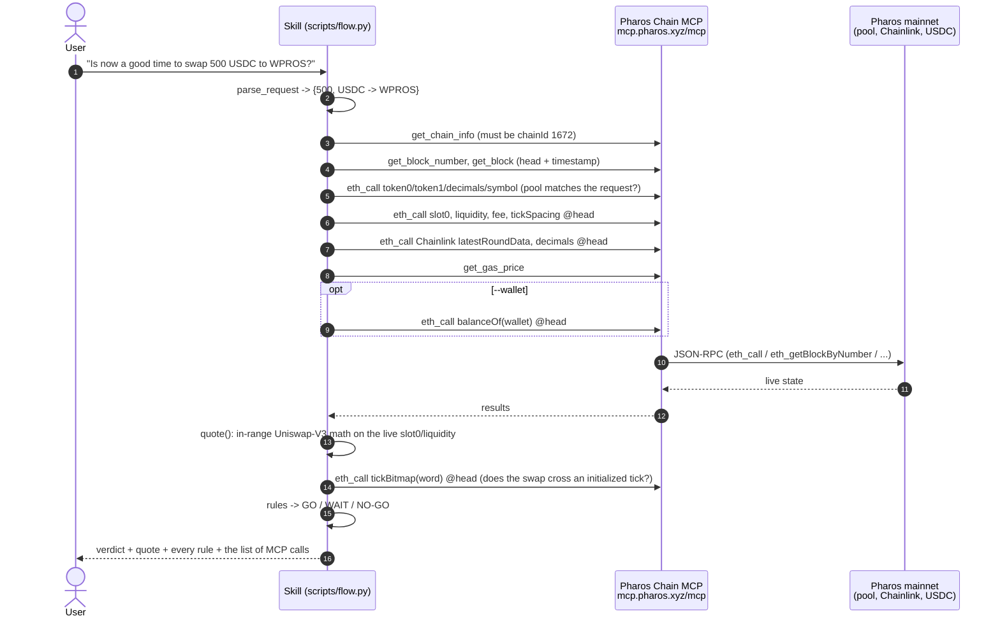

# Flow: what calls what, in what order

Plain text: **Skill** (parse) → **Chain MCP** (≈ 16–18 read calls, all pinned to one head block except
`get_gas_price`) → **Skill** (quote + tick-range check, which itself needs one more Chain MCP `tickBitmap`
read) → answer. The verdict cannot be produced without the live data: impact, deviation, oracle age and the
balance rule are all computed from values fetched in the same run.

## Quote

Exact-input, inside the current tick range (`L` = `liquidity()`, `√P` = `sqrtPriceX96 / 2^96`, fee from `fee()`):

* sell token0 (WPROS): `√P' = L·√P / (L + Δx·√P)`, out = `L·(√P − √P')`
* sell token1 (USDC):  `√P' = √P + Δy / L`, out = `L·(1/√P − 1/√P')`

with `Δ = amount·(1 − fee)`. The predicted tick `floor(log_1.0001(√P'^2))` is checked against the pool's
`tickBitmap`; if an initialized tick lies in between (or the move spans more than 8 bitmap words) the in-range
formula does not hold → NO-GO "split the order".

## Rules

`assets/rules.json` (`assets/rules.strict.json` = same with 0.1 % deviation):

| rule | severity | default |
|---|---|---|
| range — no initialized tick crossed | NO-GO | – |
| impact — \|execution price − spot\| / spot | NO-GO | ≤ 0.5 % |
| balance — wallet holds the input amount (only with `--wallet`) | NO-GO | – |
| oracle_dev — \|pool spot − Chainlink PROS/USD\| / Chainlink | WAIT | ≤ 1 % |
| oracle_fresh — head timestamp − `updatedAt` | WAIT | ≤ 3900 s (heartbeat 3600 s + 5 min) |
| gas — `get_gas_price` | WAIT | ≤ 20 gwei |

## Backtest

`scripts/backtest.py` takes real `Swap` events of the pool, reads the pool state at block N−1 through Chain MCP,
runs the same `quote()` on the real input and compares with the real output. Swaps whose liquidity changed
(tick crossed) or that were not the first in their block are skipped.
